# 🎮 Playnite Game Library

Eine selbst gehostete, moderne Webseite für deine **Playnite**-Spielesammlung – mit Suche, Filtern, Steam-Infos, Trailern, Screenshots und optionalen **KI-Steckbriefen („Good to Know“)** aus Gamer-Sicht. Läuft als Docker-Stack (z. B. in Portainer auf Proxmox) und wird per Knopfdruck oder Skript mit einem neuen Playnite-Export aktualisiert.

> *English summary:* Self-hosted web UI for a Playnite library export (Playnite "HTML Exporter" add-on). Docker Compose / Portainer stack: nginx + a small Python updater (stdlib only). Upload a new export via web button or script, missing covers and Steam store data are added automatically, optional AI summaries via Ollama, OpenAI or Claude. UI and parser are currently German – see [Limitations](#bekannte-einschränkungen).

<p align="center">
  
  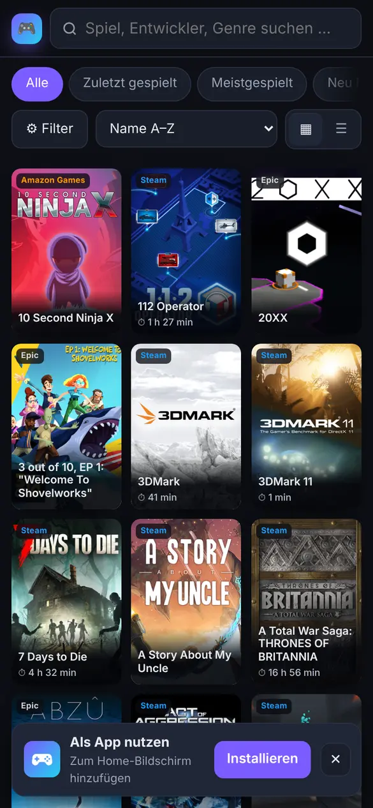
</p>

Weitere Bilder: [Screenshots](#screenshots)

---

## Inhalt

- [Funktionen](#funktionen)
- [So funktioniert es](#so-funktioniert-es)
- [Schnellstart (Docker Compose)](#schnellstart-docker-compose)
- [Installation mit Portainer](#installation-mit-portainer)
- [Erster Import](#erster-import)
- [Admin-Anmeldung](#admin-anmeldung)
- [Als App am Handy installieren](#als-app-am-handy-installieren)
- [Seitentitel & Icon ändern](#seitentitel--icon-ändern)
- [Spiele aktualisieren](#spiele-aktualisieren)
- [KI-Texte](#ki-texte)
- [Konfiguration (Umgebungsvariablen)](#konfiguration-umgebungsvariablen)
- [Backup & Neuinstallation](#backup--neuinstallation)
- [Bekannte Einschränkungen](#bekannte-einschränkungen)
- [Screenshots](#screenshots)
- [Weitere Anleitungen](#weitere-anleitungen)

---

## Funktionen

- **Modernes Design** (Dark Mode), Raster- und Listenansicht, optimiert für Desktop **und Handy** (Filter als Bottom-Sheet, Wischgesten, Zurück-Taste schließt Detailansicht)
- **Schnellsuche** über Titel, Entwickler, Genres, Tags … (Taste `/`)
- **Filter** nach Bibliothek, Status, Genre, Eigenschaften, Quelle, Entwickler, Publisher, Jahrzehnt, Installiert/Favorit …; Schnellansichten *Zuletzt gespielt*, *Meistgespielt*, *Neu*, *Backlog*; Sortierung
- **Detailansicht** mit Spielzeit, Status, Metacritic/Community/Kritiker-Wertung, Steam-Beschreibung („Über das Spiel“), Trailer, Screenshots, Sprachen, Systemanforderungen, Links
- **Fehlende Cover** werden automatisch über den Steam-Store ergänzt
- **Steam-Details** (deutsch) für alle Steam-Spiele und per Namenssuche zugeordnete Spiele anderer Stores
- **„Good to Know“-KI-Steckbriefe**: Pitch, Gameplay, Highlights, Hinweise, „Für wen?“ – erzeugt mit **Ollama** (lokal, kostenlos), **OpenAI** oder **Claude**; komplett über die Webseite steuer- und konfigurierbar
- **Versteckte Admin-Anmeldung**: Besucher sehen nur die Bibliothek – Import und KI-Verwaltung erscheinen erst nach dem Login
- **Import-Button** auf der Seite (Ordner oder ZIP hochladen) und **Update-Skripte** für Windows/Linux
- **Als App installierbar** (PWA): Symbol auf dem Home-Bildschirm, Vollbild ohne Browserleiste, zuletzt geladener Stand auch offline
- Persistente Caches: ein erneuter Import lädt nur Neues nach

## So funktioniert es

```
 Playnite (Windows)                Docker-Host (z. B. Proxmox-LXC mit Portainer)
 ┌──────────────────┐   Upload    ┌──────────────────────────────────────────────┐
 │ HTML-Export      │ ──────────▶ │ updater (Python)                             │
 │ (Add-on          │  /api/import│  • entpackt, ergänzt Cover, baut games.json   │
 │  „HTML Exporter“)│             │  • lädt Steam-Details, erzeugt KI-Texte       │
 └──────────────────┘             │  • tauscht die Seite atomar aus               │
                                  │        │ Volume "html"                        │
 Browser / Handy  ◀────────────── │ web (nginx) ── /api/* ─▶ updater               │
                                  └──────────────────────────────────────────────┘
                                     Volume "data": Caches, KI-Texte, KI-Einstellungen
```

| Pfad | Inhalt |
|------|--------|
| `app/updater.py` | Update-Dienst + API (`/api/status`, `/api/login`, `/api/import`, `/api/ai/*`), erzeugt App-Manifest, Service Worker und App-Icons |
| `app/gen.py` | liest die Playnite-Detailseiten und erzeugt `games.json` |
| `app/app.html` | die Webseite (Single-Page-App, ohne externe Abhängigkeiten) |
| `docker-compose.yml` | Stack mit `web` (nginx) und `updater` |
| `scripts/` | Update-Skripte für Windows (PowerShell) und Linux/macOS |

Der Updater nutzt ausschließlich die Python-Standardbibliothek – kein `pip install`, keine Datenbank.

---

## Schnellstart (Docker Compose)

Voraussetzung: ein Linux-Host mit Docker und Docker Compose.

```bash
git clone https://github.com/iEnki/playnite-game-library.git
cd playnite-game-library
cp .env.example .env
nano .env          # UPDATE_TOKEN + ADMIN_PASSWORD setzen, SITE_TITLE anpassen
docker compose up -d --build
```

Danach ist die Seite unter `http://<host>:8095` erreichbar (Port über `WEB_PORT` änderbar). Beim ersten Start ist die Bibliothek leer – weiter mit [Erster Import](#erster-import).

Token erzeugen: `openssl rand -base64 24`

## Installation mit Portainer

**Variante A – Stack direkt aus diesem Git-Repository (empfohlen)**

1. Portainer → *Stacks* → *Add stack* → **Repository**
2. *Repository URL*: `https://github.com/iEnki/playnite-game-library`
   *Repository reference*: `refs/heads/main` · *Compose path*: `docker-compose.yml`
3. Solange das Repo **privat** ist: *Authentication* aktivieren, GitHub-Benutzername und einen **Personal Access Token** (fine-grained, nur dieses Repo, Recht *Contents: Read-only*) eintragen.
4. Unter *Environment variables* mindestens `UPDATE_TOKEN`, `ADMIN_PASSWORD` und `SITE_TITLE` setzen (siehe [`.env.example`](.env.example)).
5. *Deploy the stack*. Portainer baut das Updater-Image aus `app/` selbst.

Updates des Codes: Stack öffnen → *Pull and redeploy* (optional mit *Re-pull image*).

**Variante B – per SSH auf dem Docker-Host**

```bash
git clone https://github.com/iEnki/playnite-game-library.git /opt/playnite-game-library
cd /opt/playnite-game-library && cp .env.example .env && nano .env
docker compose up -d --build
```
Der Stack erscheint in Portainer als „Limited“-Stack und lässt sich dort überwachen.

**Reverse Proxy / eigene Domain** (z. B. Nginx Proxy Manager): siehe [docs/REVERSE-PROXY.md](docs/REVERSE-PROXY.md) – wichtig ist ein großes Upload-Limit (`client_max_body_size 2g;`).

## Erster Import

1. In Playnite das Add-on **HTML Exporter** installieren (*Add-ons → Durchsuchen → „HTML Exporter“*).
2. Export starten (*Erweiterungen → HTML Exporter*). Playnite muss auf **Deutsch** eingestellt sein (siehe [Einschränkungen](#bekannte-einschränkungen)). Der Export ist ein Ordner mit `index.html`, vielen `<GUID>.html`-Seiten und Bilderordnern.
3. Webseite öffnen → als Admin anmelden (siehe [Admin-Anmeldung](#admin-anmeldung)) → **⇪ Import** (oben rechts, nur am Desktop sichtbar) → **Export-Ordner wählen** (oder eine ZIP-Datei des Ordners).
4. Der Fortschritt wird live angezeigt: Entpacken → Cover ergänzen → `games.json` → Steam-Details → KI-Texte übernehmen → Seite aktivieren. Der erste Import dauert wegen der Steam-Abfragen einige Minuten, spätere Importe gehen dank Cache schnell.

Danach können die KI-Texte erzeugt werden – siehe [KI-Texte](#ki-texte).

## Admin-Anmeldung

Für Besucher ist die Seite eine reine Bibliothek – **kein Login-Button, kein Import, keine KI-Verwaltung**. Als Admin meldest du dich über einen versteckten Zugang an:

| Weg | So geht's |
|-----|-----------|
| Adresse | `https://deine-seite/#login` (oder `#admin`) aufrufen – am einfachsten als Lesezeichen speichern |
| Handy | das **Logo oben links ca. 1 Sekunde gedrückt halten** |
| Tastatur | `Strg` + `Umschalt` + `L` |

Passwort = `ADMIN_PASSWORD` aus dem Stack (ist es leer, gilt das `UPDATE_TOKEN`). Mit „Angemeldet bleiben“ hält die Anmeldung `SESSION_DAYS` Tage (Standard 30), sonst 1 Tag. Danach erscheinen oben **✨ KI-Texte**, **⇪ Import** und **🔓 Abmelden**.

Sicherheit: Die Sitzung ist ein signiertes, `HttpOnly`-/`SameSite=Strict`-Cookie (über HTTPS zusätzlich `Secure`); Passwort und Token gelangen nie in den Browser-Speicher. Nach 5 Fehlversuchen wird die IP für 15 Minuten gesperrt. Ein neues `ADMIN_PASSWORD` meldet alle Geräte ab. Die Update-Skripte nutzen weiterhin das `UPDATE_TOKEN`.

<p align="center">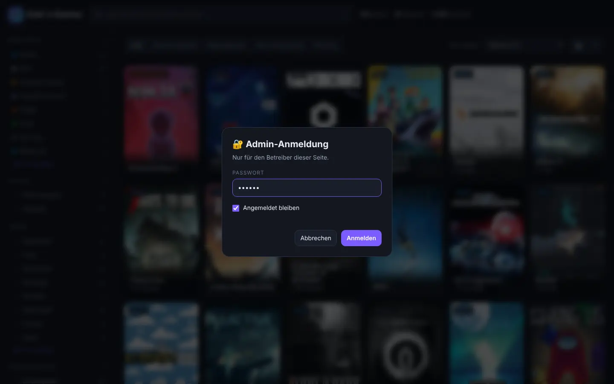</p>

## Als App am Handy installieren

Die Seite ist eine **Progressive Web App** – sie lässt sich wie eine App auf den Home-Bildschirm legen und startet dann im Vollbild ohne Browserleiste:

- **Android (Chrome/Edge/Samsung Internet):** Seite öffnen → Hinweis **„Als App nutzen → Installieren“** unten antippen, oder Menü ⋮ → *App installieren* / *Zum Startbildschirm hinzufügen*.
- **iPhone/iPad (Safari):** Teilen-Symbol → **„Zum Home-Bildschirm“** → *Hinzufügen*.
- Der Link **„📲 Als App installieren“** ganz unten auf der Seite zeigt die Anleitung jederzeit.

Voraussetzung ist **HTTPS** (z. B. über Nginx Proxy Manager, siehe [docs/REVERSE-PROXY.md](docs/REVERSE-PROXY.md)) – über `http://IP:Port` lässt sich die Seite zwar als Lesezeichen ablegen, aber nicht als App installieren. Der zuletzt geladene Stand (Liste und bereits angesehene Cover) ist auch offline verfügbar; nach einem Import zeigt die App beim nächsten Öffnen automatisch den neuen Stand.

App-Name = `SITE_TITLE`. Das App-Symbol (Gamepad auf Farbverlauf) wird automatisch erzeugt; ein eigenes Symbol als quadratisches PNG (mind. 512×512) unter dem Namen `icon.png` ins `data`-Volume legen und den Updater-Container neu starten.

<p align="center">
  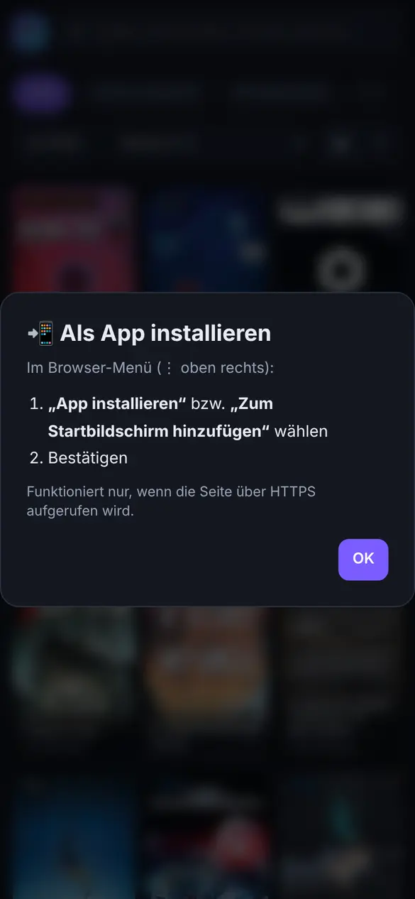
</p>

## Seitentitel & Icon ändern

Titel (Browser-Tab und Kopfzeile) und Icon werden über **zwei Umgebungsvariablen** gesteuert – keine Code-Änderung nötig:

| Variable | Beispiel | Standard |
|----------|----------|----------|
| `SITE_TITLE` | `Enki´s Games` | `My Game Library` |
| `SITE_ICON` | `🕹️` (ein Emoji) | `🎮` |

**Portainer:** Stack öffnen → *Environment variables* → `SITE_TITLE` ändern → *Update the stack*.
**Docker Compose:** Wert in `.env` ändern → `docker compose up -d`.

Der Updater-Container wird dabei neu erstellt und schreibt die Seite beim Start mit dem neuen Titel neu – die Spieldaten bleiben unverändert. Danach Seite im Browser neu laden (ggf. `Strg+F5`).

Farben, Layout und Texte lassen sich in `app/app.html` anpassen – siehe [docs/CUSTOMIZING.md](docs/CUSTOMIZING.md).

## Spiele aktualisieren

Nach Änderungen in Playnite einfach neu exportieren und hochladen:

- **Webseite:** als Admin anmelden → Button **⇪ Import** → Ordner wählen.
- **Windows-Skript** [`scripts/Update-GameLibrary.ps1`](scripts/Update-GameLibrary.ps1):
  ```powershell
  # einmalig Einstellungen speichern
  [Environment]::SetEnvironmentVariable('GAMELIB_EXPORT','C:\Users\me\Downloads\My Games','User')
  [Environment]::SetEnvironmentVariable('GAMELIB_URL','http://192.168.1.20:8095','User')
  [Environment]::SetEnvironmentVariable('GAMELIB_TOKEN','<UPDATE_TOKEN>','User')
  # danach jederzeit
  powershell -ExecutionPolicy Bypass -File .\scripts\Update-GameLibrary.ps1
  ```
- **Linux/macOS:** `GAMELIB_URL=… GAMELIB_TOKEN=… ./scripts/update-library.sh "/pfad/zum/export"`

Die alte Seite bleibt bis zum fertigen Import online; bei einem Fehler wird nichts ausgetauscht.

## KI-Texte

Button **✨ KI-Texte** auf der Seite (nur nach der [Admin-Anmeldung](#admin-anmeldung) sichtbar):

- **Erzeugen:** alle Spiele, ausgewählte Bibliotheken, die aktuelle Filteransicht oder einzelne Spiele; Modus *nur fehlende*, *fehlende + anderes Modell* oder *alle neu*; optional auch Spiele ohne Steam-Daten (die KI nutzt dann ihr eigenes Wissen und überspringt unbekannte Spiele). Fortschritt, Restzeit, Protokoll und Stopp-Button inklusive.
- **KI-Einstellungen:** Anbieter **Ollama** (lokal), **OpenAI** (oder kompatibel, z. B. OpenRouter/LM Studio) oder **Claude**; API-Key, Modell (per „Verbindung testen“ auswählbar), Kreativität, Kontext, Timeout, parallele Anfragen, Stil-Prompt; automatische Erzeugung nach einem Import.
- Einzelne Spiele: in der Detailansicht „✨ KI-Text erzeugen“ bzw. im Popup „↻ Text neu erzeugen“.

API-Keys werden nur im Daten-Volume (`ai_config.json`, Dateirechte 600) gespeichert und nie an den Browser zurückgegeben. Details, Kosten und Tipps: [docs/AI.md](docs/AI.md).

## Konfiguration (Umgebungsvariablen)

| Variable | Pflicht | Beschreibung |
|----------|:------:|--------------|
| `UPDATE_TOKEN` | ✔ | Geheimnis für die Update-Skripte (Header `X-Token`) |
| `ADMIN_PASSWORD` | empfohlen | Passwort für die Admin-Anmeldung auf der Webseite (leer = `UPDATE_TOKEN`) |
| `SESSION_DAYS` | | Dauer von „Angemeldet bleiben“ in Tagen (Standard `30`) |
| `SITE_TITLE` | | Seitentitel und App-Name (Standard `My Game Library`) |
| `SITE_ICON` | | Emoji im Kopf (Standard `🎮`) |
| `WEB_PORT` | | Port am Host (Standard `8095`) |
| `OLLAMA_URL` | | Standard-Ollama-Server, solange in der Weboberfläche nichts gespeichert ist (Standard `http://host.docker.internal:11434`) |
| `OLLAMA_MODEL` | | Standard-Ollama-Modell |
| `TZ` | | Zeitzone für Protokolle |

Fortgeschritten: `SITE_DIR`, `DATA_DIR`, `CONF_DIR` (Pfade im Container, Standard `/site`, `/data`, `/conf`).

## Backup & Neuinstallation

Alles Wichtige liegt in Volumes:

| Volume | Inhalt | Sichern? |
|--------|--------|:-------:|
| `data` | KI-Texte, KI-Einstellungen inkl. API-Keys, Steam-Cache, Cover-Zuordnungen | **ja** |
| `html` | veröffentlichte Seite (aus dem Export neu erzeugbar) | optional |
| `conf` | generierte nginx-Konfiguration | nein |

Neuinstallation auf einem neuen Server: Repo klonen/als Stack anlegen → `data`-Backup zurückspielen → Export erneut importieren. Schritt-für-Schritt-Befehle (auch für die Übernahme einer bestehenden Installation): [docs/BACKUP-RESTORE.md](docs/BACKUP-RESTORE.md).

## Bekannte Einschränkungen

- Der Parser (`app/gen.py`) erwartet einen **deutschsprachigen** Playnite-Export (Feldnamen wie „Spielzeit“, „Letzte Aktivität“, Datumsformat `TT.MM.JJJJ`). Für andere Sprachen müssen die Bezeichnungen in `gen.py` ergänzt werden – Beiträge willkommen.
- Die Oberfläche ist deutsch.
- Steam-Daten werden per Namenssuche zugeordnet; bei sehr ähnlichen Titeln kann es selten Fehltreffer geben (korrigierbar über `mapping.json` im Daten-Volume, siehe [docs/BACKUP-RESTORE.md](docs/BACKUP-RESTORE.md#cover--steam-zuordnung-korrigieren)).
- Der Import-Button ist auf dem Handy ausgeblendet (Ordner-Upload ist dort nicht sinnvoll).

## Screenshots

Bibliothek, Detailansicht und KI-Steckbrief:

<p align="center">
  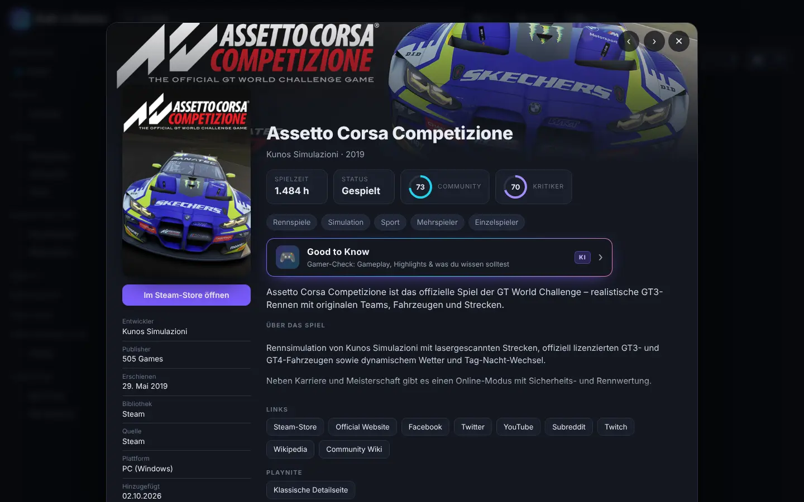
  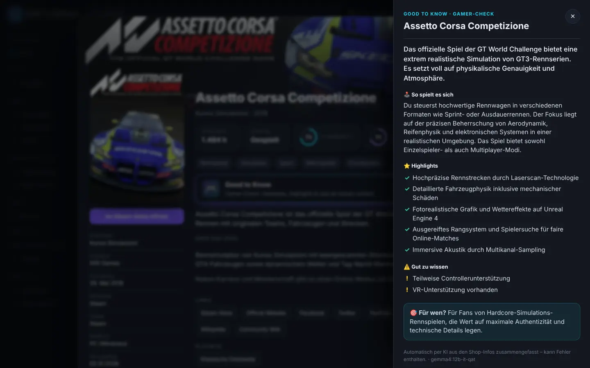
</p>

Am Handy:

<p align="center">
  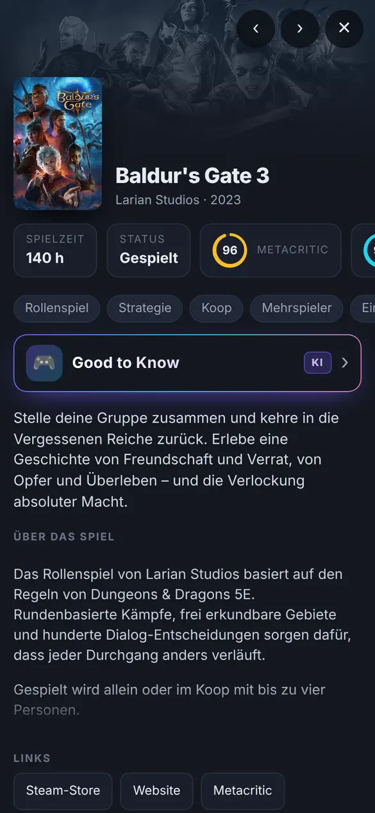
  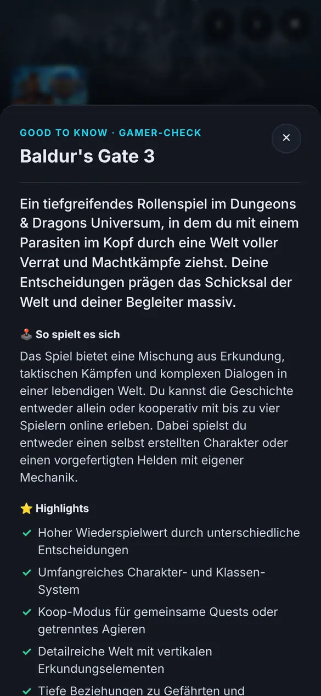
  
</p>

Admin-Bereich (nach dem Login):

<p align="center">
  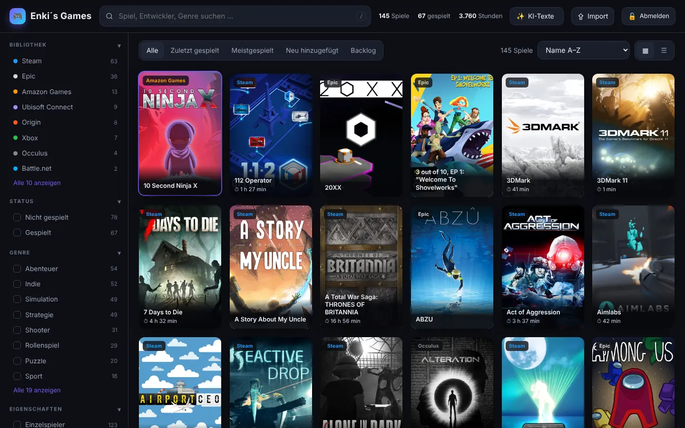
  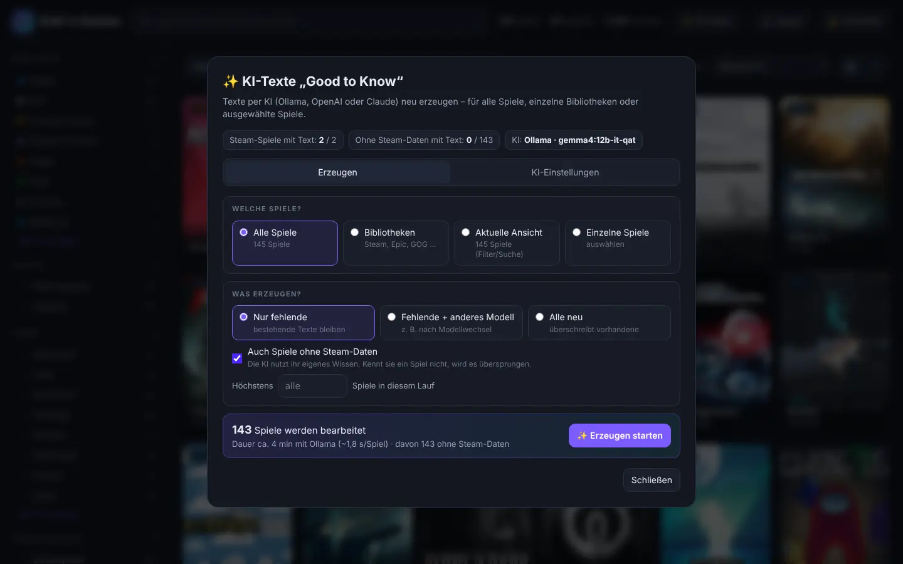
  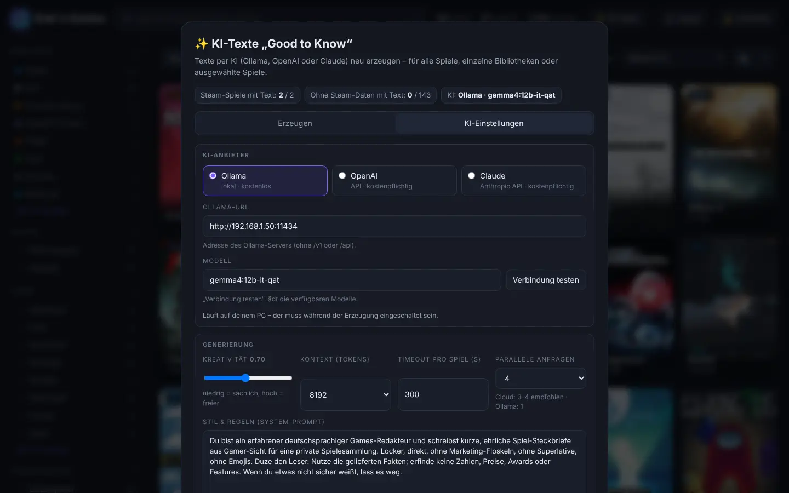
  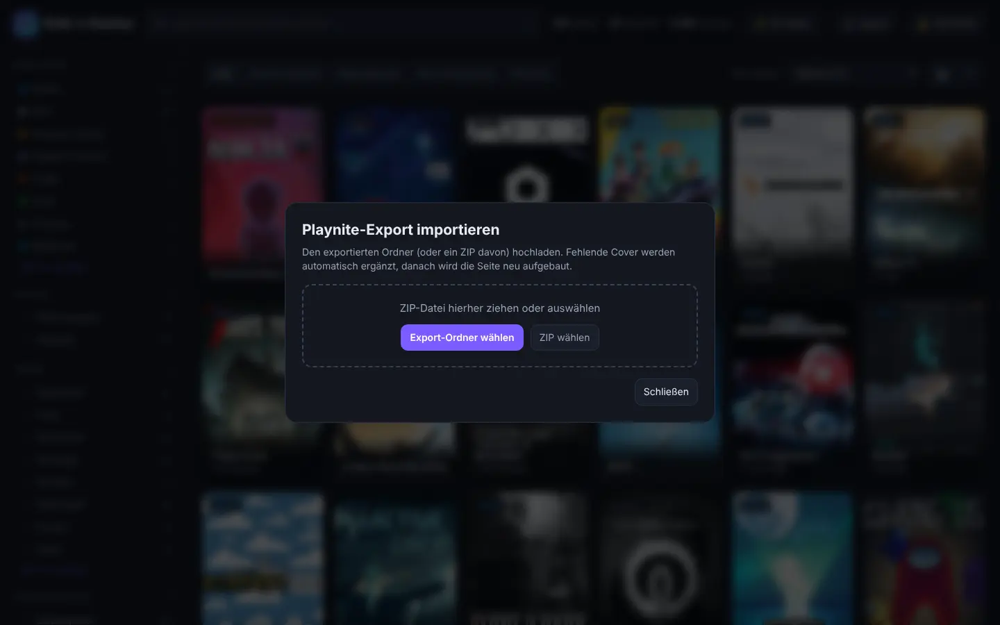
</p>

## Weitere Anleitungen

- [docs/CUSTOMIZING.md](docs/CUSTOMIZING.md) – Titel, Icon, Farben, Port
- [docs/AI.md](docs/AI.md) – KI-Anbieter, Modelle, Kosten
- [docs/REVERSE-PROXY.md](docs/REVERSE-PROXY.md) – Nginx Proxy Manager / eigene Domain / HTTPS
- [docs/BACKUP-RESTORE.md](docs/BACKUP-RESTORE.md) – Sicherung, Umzug, Neuinstallation

## Lizenz

[MIT](LICENSE). Playnite ist ein eigenständiges Projekt und steht in keiner Verbindung zu diesem Repository. Steam-Daten und -Bilder gehören den jeweiligen Rechteinhabern und werden nur zur privaten Anzeige abgerufen.
